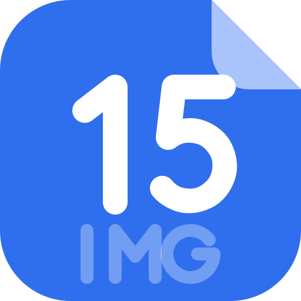
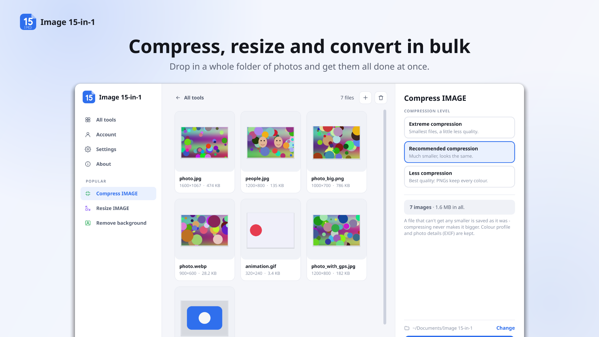
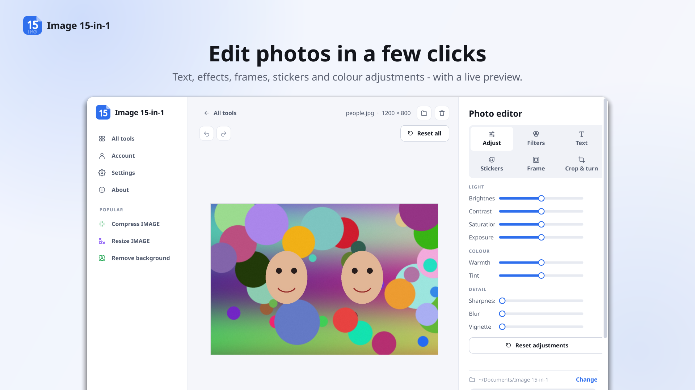
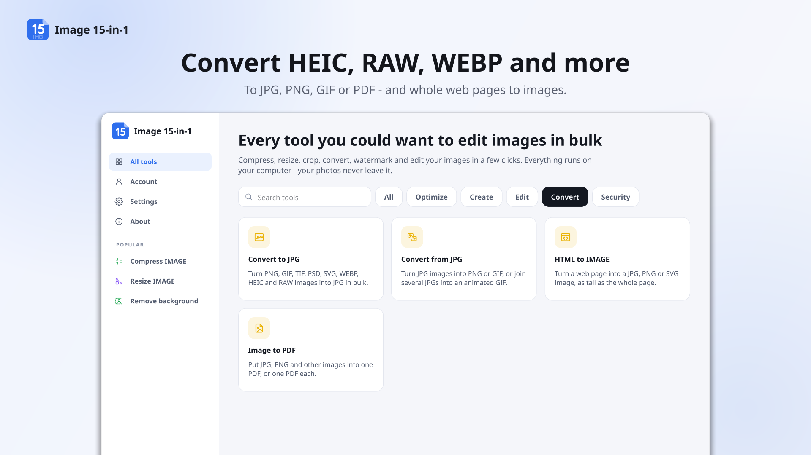
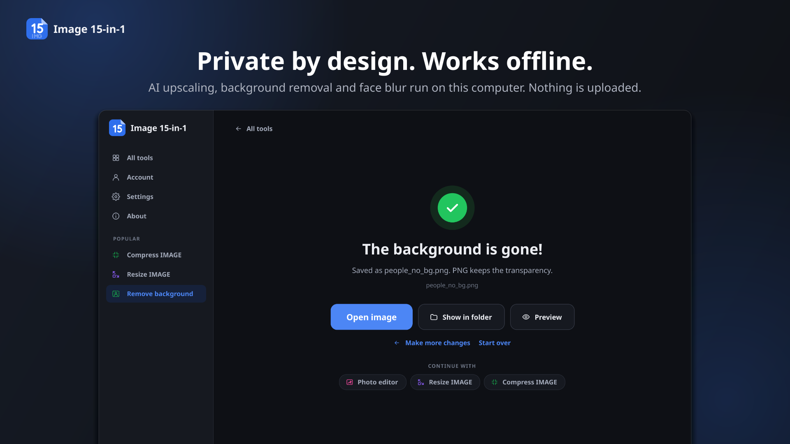

<h1 align="center">
  <br>
  Image 15-in-1: Offline Image Editor and Converter for Linux and Windows
</h1>

<p align="center">
  <b>15 image tools in one desktop app. Compress, resize, crop, convert, upscale, remove backgrounds and blur faces on your own computer.</b><br>
  No uploads, no sign-up, no watermarks. Works offline on Windows 10 and 11, Ubuntu, Fedora, Debian, Linux Mint, Arch and any other Linux.
</p>

<p align="center">
  <a href="https://snapcraft.io/image-15-in-1"></a>
  <a href="https://github.com/rishabh3354/IMAGE-15-IN-1/releases/latest"></a>
  <a href="https://github.com/rishabh3354/IMAGE-15-IN-1/releases"></a>
  
  
  
</p>

<p align="center">
  <a href="https://snapcraft.io/image-15-in-1"></a>&nbsp;
  <a href="https://flathub.org/apps/com.warlordsoftwares.image-15-in-1"></a>&nbsp;
  <a href="https://github.com/rishabh3354/IMAGE-15-IN-1/releases/latest/download/Image-15-in-1-x86_64.AppImage"></a>
</p>

<p align="center">
  <a href="https://github.com/rishabh3354/IMAGE-15-IN-1/releases/latest/download/Image-15-in-1.exe"></a>
</p>

<p align="center">
  
</p>

**Image 15-in-1** is an all-in-one **image editor, image converter and photo toolkit for Linux and Windows**. It
does what online sites like iLoveIMG, TinyPNG and remove.bg do, but every photo stays on your computer. Compress
images for the web, **resize photos in bulk**, convert **HEIC to JPG** (iPhone photos), RAW, WEBP and PNG,
**upscale pictures with AI**, **remove backgrounds**, blur faces and strip GPS data, all without an internet
connection.

## Contents

- [Why Image 15-in-1](#why-image-15-in-1)
- [Install on Linux](#install-on-linux)
- [Install on Windows](#install-on-windows)
- [All 15 image tools](#all-15-image-tools)
- [Supported formats](#supported-formats)
- [Screenshots](#screenshots)
- [Free and PRO](#free-and-pro)
- [FAQ](#frequently-asked-questions)
- [Support](#support-and-feedback)

## Why Image 15-in-1

- **Private by design.** Your photos are processed on your own computer and never uploaded. Safe for family
  pictures, ID photos, screenshots of documents and anything else you wouldn't put on a website.
- **AI that runs on your computer.** Upscaling (Real-ESRGAN), background removal (U²-Net) and face finding (YuNet)
  come with the app. Nothing to download, no cloud, no account, no credits.
- **Works offline.** On a plane, behind a company firewall or with no connection at all, every tool still works.
- **15 tools, one app.** No more switching between an image compressor, a resizer, a HEIC converter and an online
  background remover. Everything has the same simple flow: choose images, pick options, done.
- **Batch processing.** Drop in a whole folder of photos and compress, resize, convert, rotate or watermark them
  all at once.
- **No limits on file size, no queues, no watermarks.** Big photos are processed at the speed of your own
  computer.
- **Easy to use.** Drag and drop images, see a live preview, light and dark themes, touchscreen support, and an
  interface in 20 languages.

## Install on Linux

### Snap (Ubuntu and most distributions)

```bash
sudo snap install image-15-in-1
```

Or open **Ubuntu Software** / **App Center**, search for *Image 15-in-1* and click Install.

### Flatpak (Fedora, Linux Mint, Pop!_OS, elementary OS, Arch and more)

```bash
flatpak install flathub com.warlordsoftwares.image-15-in-1
```

### AppImage (any Linux, no installation)

1. **[Download Image-15-in-1-x86_64.AppImage](https://github.com/rishabh3354/IMAGE-15-IN-1/releases/latest/download/Image-15-in-1-x86_64.AppImage)**
   (or pick a version from [all releases](https://github.com/rishabh3354/IMAGE-15-IN-1/releases)).
2. Make it executable and run it:

```bash
chmod +x Image-15-in-1-x86_64.AppImage
```

```bash
./Image-15-in-1-x86_64.AppImage
```

Every version (Snap, Flatpak and AppImage) includes the AI models, so all 15 tools work from the first start.

## Install on Windows

Image 15-in-1 runs on **Windows 10 and Windows 11** (64-bit).

### Windows installer (.exe)

1. **[Download Image-15-in-1.exe](https://github.com/rishabh3354/IMAGE-15-IN-1/releases/latest/download/Image-15-in-1.exe)**
   (or pick a version from [all releases](https://github.com/rishabh3354/IMAGE-15-IN-1/releases)).
2. Run it and follow the setup steps. Image 15-in-1 appears in the Start menu, and you can add it to
   "Open with" for JPG, PNG, HEIC and other images.

If Windows SmartScreen shows "Windows protected your PC", click **More info → Run anyway**.

The AI models are included, so upscaling, background removal and face blur work offline right away.

## All 15 image tools

### Optimize

| Tool | What it does |
| --- | --- |
| **Compress image** | Make JPG, PNG, SVG and GIF files smaller while keeping the quality: extreme, recommended or less compression. |
| **Upscale image** | Enlarge photos 2× or 4× with AI, sharp instead of blurry. |
| **Remove background** | Find the main subject and cut out the background: a transparent PNG, or the subject on white or any colour. |

### Edit

| Tool | What it does |
| --- | --- |
| **Resize image** | Set a new size by percentage or exact pixels, keeping the aspect ratio, for many images at once. |
| **Crop image** | Cut out part of an image by pixels, or by drawing the area on the picture. |
| **Rotate image** | Rotate many images at once, or only the portrait or landscape ones. |
| **Watermark image** | Stamp text or a logo over your images, with the font, transparency and position you choose, or repeat it over the whole picture. |

### Convert

| Tool | What it does |
| --- | --- |
| **Convert to JPG** | Turn PNG, GIF, TIFF, PSD, SVG, WEBP, HEIC and camera RAW images into JPG in bulk, or every frame of a GIF into its own JPG. |
| **Convert from JPG** | Turn JPG images into PNG or GIF, or join several JPGs into an animated GIF. |
| **Image to PDF** | Put JPG, PNG and other images into one PDF, or one PDF each, with the page size and margin you choose. |
| **HTML to image** | Turn a web page or HTML file into a JPG, PNG or SVG image, as tall as the whole page, with ads and pop-ups removed. |

### Create

| Tool | What it does |
| --- | --- |
| **Photo editor** | Adjust light and colour, add filters, text, stickers and frames, crop and turn, with undo. |
| **Meme generator** | Put top and bottom captions on any picture to make your own meme. |

### Security

| Tool | What it does |
| --- | --- |
| **Blur face** | Find faces with AI and blur, pixelate or mosaic them, or mark any area yourself: number plates, names, anything private. |
| **Remove metadata** | Strip EXIF data (GPS location, camera, dates) before you share a photo. |

## Supported formats

| | Formats |
| --- | --- |
| **Opens** | JPG, PNG, GIF (animated too), WEBP, BMP, TIFF, PSD, ICO, AVIF, SVG, HEIC / HEIF (iPhone photos) and camera RAW: CR2, CR3, NEF, ARW, DNG, ORF, RW2, RAF, PEF and more |
| **Saves** | JPG, PNG, GIF, animated GIF, PDF and SVG (HTML to image) |

## Screenshots

<p align="center">
  
  
  
  
</p>

## Free and PRO

- **Free:** every tool, 3 tasks a day, up to 10 images a task, no watermarks on your images.
- **PRO:** unlimited tasks with a one-time payment, or a 1-month or 3-month plan. New installs get 7 days of PRO
  free. See [plans and pricing](https://warlordsoftwares.com/apps/plans-and-pricing/?product=IMAGE15IN1).

## Languages

English, العربية, Deutsch, Español, Français, हिन्दी, Bahasa Indonesia, Italiano, 日本語, 한국어, Nederlands, Polski,
Português (Brasil), Русский, Svenska, ไทย, Türkçe, Українська, Tiếng Việt and 简体中文. The app follows your
computer's language, and you can change it in Settings.

## Frequently asked questions

### Is Image 15-in-1 a good offline alternative to iLoveIMG, TinyPNG or remove.bg?

Yes. It covers the same everyday tools (compress, resize, crop, convert, upscale, remove background, watermark)
as a desktop app, so your photos are never uploaded to someone else's server and you don't need an internet
connection.

### Are my photos uploaded anywhere?

No. Every tool runs on your own computer, the AI tools included. The only tool that uses the internet is HTML to
image, and only when you type a web address to capture.

### How do I convert HEIC to JPG on Linux?

Open Image 15-in-1, choose **Convert to JPG**, drop in your iPhone photos and click Convert. It works the same for
WEBP, PNG, TIFF, PSD, SVG and camera RAW files, many at once.

### How do I compress images without losing quality?

Choose **Compress image** and keep **Recommended compression**: files get much smaller and look the same. A file
that can't get any smaller is saved as it was, so compressing never makes an image bigger, and your originals are
never changed.

### How do I resize many photos at once?

Choose **Resize image**, drop in all your photos, set the new size by percentage or pixels and click Resize.

### Can I remove the background from a photo offline?

Yes. **Remove background** uses an AI model that comes with the app, so it works without an internet connection
and with no credits or sign-up. You get a transparent PNG, or the subject on white or any colour you pick.

### Can I upscale a low-resolution photo?

Yes. **Upscale image** enlarges a picture 2× or 4× with Real-ESRGAN, which adds sharp detail instead of the blur
you get from a plain resize.

### Which Linux distributions are supported?

Any 64-bit (x86_64) Linux with Snap, Flatpak or AppImage support, including Ubuntu, Fedora, Debian, Linux Mint,
Pop!_OS, elementary OS, Zorin OS, Manjaro, Arch Linux and openSUSE.

## Support and feedback

- Found a bug or want a new tool? [Open an issue](https://github.com/rishabh3354/IMAGE-15-IN-1/issues).
- Questions about PRO or your account: [contact us](https://warlordsoftwares.com/contact-us/).
- If Image 15-in-1 saves you time, please **⭐ star this repository** and leave a review on the
  [Snap Store](https://snapcraft.io/image-15-in-1). It helps other people find the app.

---

<p align="center">
  Made by <a href="https://warlordsoftwares.com">Warlord Softwares</a> ·
  <a href="https://warlordsoftwares.com/apps/linux-apps/">Website</a> ·
  <a href="share/license/LICENSE">License</a>
</p>

<sub>The AI models come with their own licences: YuNet (MIT, OpenCV Zoo), Real-ESRGAN General x4v3
(BSD-3-Clause) and U²-Net (Apache-2.0). iLoveIMG, TinyPNG and remove.bg are trademarks of their respective
owners; Image 15-in-1 is not affiliated with them.</sub>
