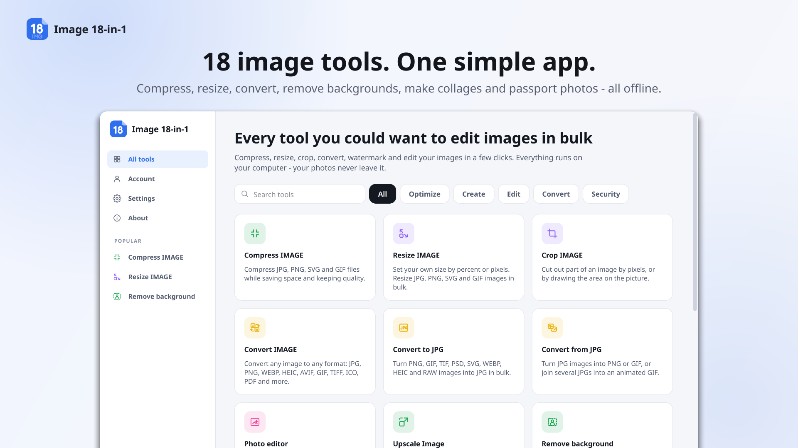
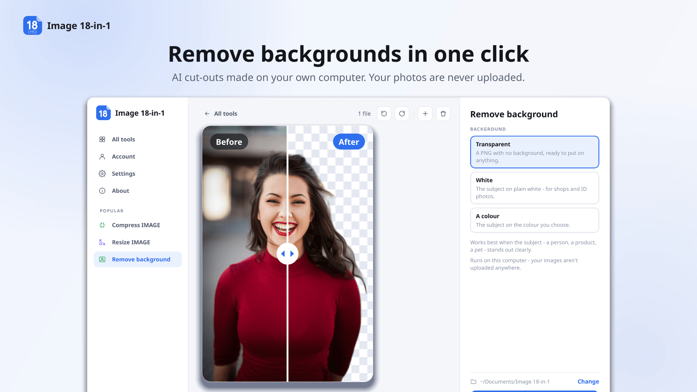
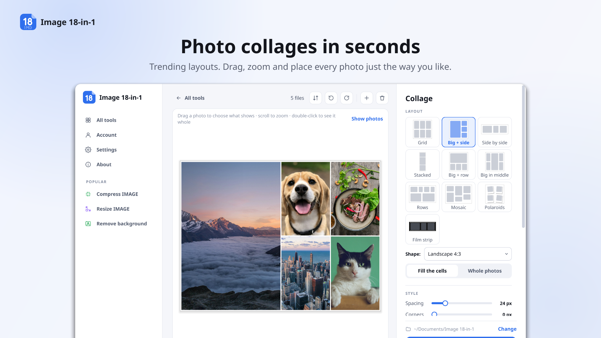
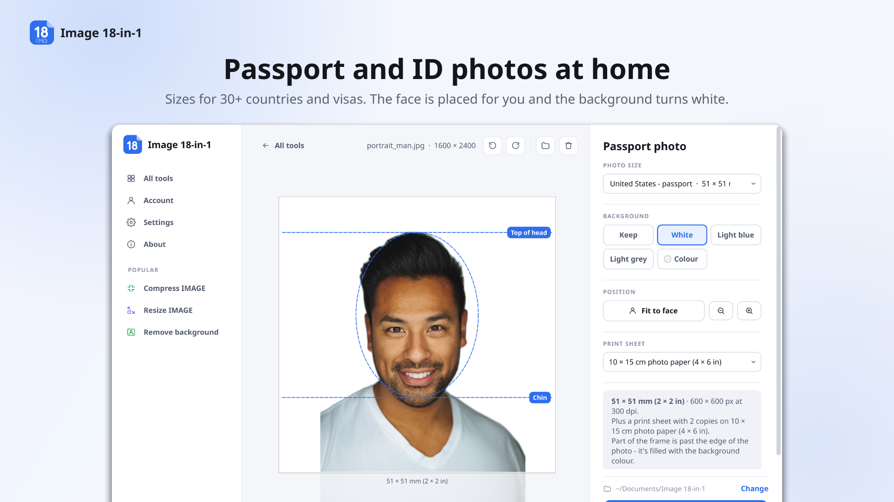
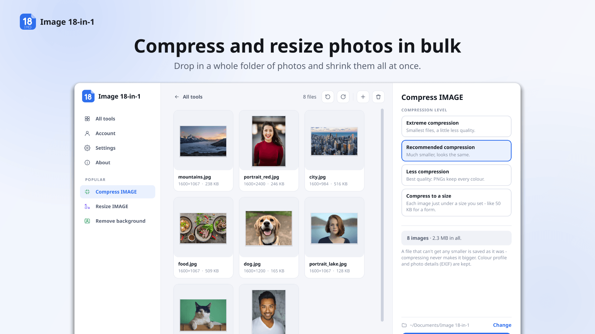
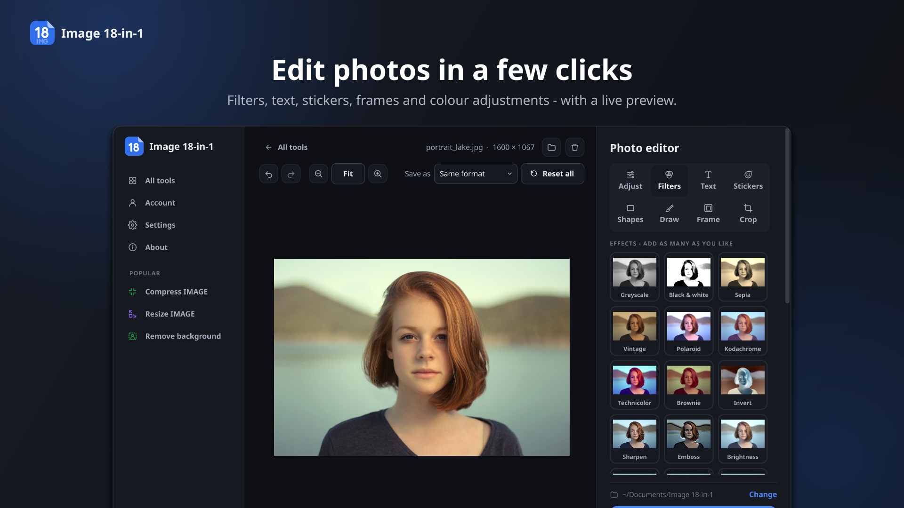
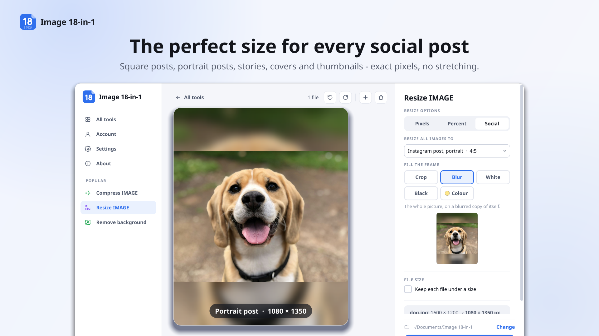

<h1 align="center">
  <br>
  Image 18-in-1: Offline Image Editor, Photo Editor and Image Converter for Linux and Windows
</h1>

<p align="center">
  <b>18 image tools in one free desktop app. Compress images to any size in KB, resize photos in bulk, convert HEIC
  to JPG, remove backgrounds with AI, make passport photos and photo collages - on your own computer.</b><br>
  No uploads, no sign-up, no watermarks. Works offline on Windows 10 and 11, Ubuntu, Fedora, Debian, Linux Mint,
  Arch and any other Linux.
</p>

<p align="center">
  <a href="https://snapcraft.io/img-18-in-1"></a>
  <a href="https://github.com/rishabh3354/IMAGE-18-IN-1/releases/latest"></a>
  <a href="https://github.com/rishabh3354/IMAGE-18-IN-1/releases"></a>
  
  
  
</p>

<p align="center">
  <a href="https://snapcraft.io/img-18-in-1"></a>&nbsp;
  <a href="https://flathub.org/apps/com.warlordsoftwares.image-18-in-1"></a>&nbsp;
  <a href="https://github.com/rishabh3354/IMAGE-18-IN-1/releases/latest/download/Image-18-in-1-x86_64.AppImage"></a>
</p>

<p align="center">
  <a href="https://github.com/rishabh3354/IMAGE-18-IN-1/releases/latest/download/Image-18-in-1.exe"></a>
</p>

<p align="center">
  
</p>

**Image 18-in-1** is an all-in-one **image editor, photo editor and image converter for
Linux and Windows**. It does what online image sites do, but every photo stays on your computer:
**compress images** to an exact size like 50 KB, **resize photos in bulk** or to **Instagram and YouTube sizes**,
convert **HEIC to JPG**, **WEBP to PNG** and camera RAW, **remove backgrounds** and **upscale pictures** with AI, make
**passport size photos** and **photo collages**, blur faces and strip GPS data - all without an internet connection.

## Contents

- [Highlights](#highlights)
- [Why use an offline image editor](#why-use-an-offline-image-editor)
- [Install on Linux](#install-on-linux) · [Install on Windows](#install-on-windows)
- [All 18 image tools](#all-18-image-tools)
- [Supported formats](#supported-formats)
- [Free and PRO](#free-and-pro)
- [FAQ](#frequently-asked-questions)
- [Support](#support-and-feedback)

## Highlights

<table>
  <tr>
    <td width="50%"></td>
    <td width="50%"></td>
  </tr>
  <tr>
    <td><b>Remove backgrounds in one click.</b> AI cut-outs made on your computer: a transparent PNG, or the subject on white or any colour.</td>
    <td><b>Photo collages in seconds.</b> 10 layouts, from grids to polaroids and film strips. Drag and zoom each photo in its frame.</td>
  </tr>
  <tr>
    <td></td>
    <td></td>
  </tr>
  <tr>
    <td><b>Passport and visa photos at home.</b> Sizes for 30+ countries. The face is placed for you, the background turns white, and a sheet of copies is ready to print.</td>
    <td><b>Compress and resize in bulk.</b> Drop in a whole folder of photos. Shrink them all at once, or get each one just under 20, 50 or 100 KB.</td>
  </tr>
  <tr>
    <td></td>
    <td></td>
  </tr>
  <tr>
    <td><b>Edit photos in a few clicks.</b> Filters, effects, text, stickers, shapes, drawing, frames and colour adjustments, with a live preview.</td>
    <td><b>The perfect size for every social post.</b> Instagram posts and stories, Facebook and X covers, YouTube thumbnails - exact pixels, no stretching.</td>
  </tr>
</table>

## Why use an offline image editor

| | Online image websites | Image 18-in-1 |
| --- | --- | --- |
| Your photos | Uploaded to someone else's server | Never leave your computer |
| Internet | Needed for every file | Not needed - every tool works offline |
| AI (background removal, upscaling) | Credits, sign-up or a monthly plan | Built in, runs on your computer |
| Big files and many files | Size limits, queues, daily caps | As fast as your own computer |
| Watermarks and ads | Often | Never |

- **Private by design.** Safe for family pictures, ID and passport photos, screenshots of documents and anything
  else you wouldn't put on a website.
- **AI that runs on your computer.** Upscaling (Real-ESRGAN), background removal (U²-Net) and face finding (YuNet)
  come with the app. Nothing to download, no cloud, no account, no credits.
- **18 tools, one app.** No more switching between an image compressor, a resizer, a HEIC converter, an online
  background remover, a passport photo website and a collage app. Every tool has the same simple flow: choose
  images, pick options, done.
- **Easy to use.** Drag and drop images, see a live preview, light and dark themes, touchscreen support, and an
  interface in 20 languages.

## Install on Linux

### Snap (Ubuntu and most distributions)

```bash
sudo snap install img-18-in-1
```

Or open **Ubuntu Software** / **App Center**, search for *Image 18-in-1* and click Install.

### Flatpak (Fedora, Linux Mint, Pop!_OS, elementary OS, Arch and more)

```bash
flatpak install flathub com.warlordsoftwares.image-18-in-1
```

### AppImage (any Linux, no installation)

1. **[Download Image-18-in-1-x86_64.AppImage](https://github.com/rishabh3354/IMAGE-18-IN-1/releases/latest/download/Image-18-in-1-x86_64.AppImage)**
   (or pick a version from [all releases](https://github.com/rishabh3354/IMAGE-18-IN-1/releases)).
2. Make it executable and run it:

```bash
chmod +x Image-18-in-1-x86_64.AppImage
```

```bash
./Image-18-in-1-x86_64.AppImage
```

Every version (Snap, Flatpak and AppImage) includes the AI models, so all 18 tools work from the first start.

## Install on Windows

Image 18-in-1 runs on **Windows 10 and Windows 11** (64-bit).

1. **[Download Image-18-in-1.exe](https://github.com/rishabh3354/IMAGE-18-IN-1/releases/latest/download/Image-18-in-1.exe)**
   (or pick a version from [all releases](https://github.com/rishabh3354/IMAGE-18-IN-1/releases)).
2. Run it and follow the setup steps. Image 18-in-1 appears in the Start menu, and you can add it to
   "Open with" for JPG, PNG, HEIC and other images.

If Windows SmartScreen shows "Windows protected your PC", click **More info → Run anyway**.

The AI models are included, so background removal, passport photos, upscaling and face blur work offline right
away.

## All 18 image tools

### Optimize

| Tool | What it does |
| --- | --- |
| **Compress image** | Make JPG, PNG, SVG and GIF files smaller while keeping the quality: extreme, recommended or less compression - or each file just under a size you choose, like 20 KB, 50 KB or 100 KB for an online form. |
| **Upscale image** | Enlarge photos 2× or 4× with AI, sharp instead of blurry. |
| **Remove background** | Find the main subject with AI and cut out the background: a transparent PNG, or the subject on white or any colour. |

### Edit

| Tool | What it does |
| --- | --- |
| **Resize image** | Set a new size by percentage or exact pixels, or pick a social media size (Instagram post and story, Facebook and X covers, YouTube thumbnail and more) and fill the frame by cropping, a blurred copy or a colour - for many images at once. |
| **Crop image** | Cut out part of an image by pixels, by drawing the area on the picture, or to a social media size. |
| **Rotate image** | Rotate many images at once, or only the portrait or landscape ones. |
| **Watermark image** | Stamp text or a logo over your images, with the font, transparency and position you choose, or repeat it over the whole picture. |

### Convert

| Tool | What it does |
| --- | --- |
| **Convert image** | Convert any image to any format: JPG, PNG, WEBP, HEIC, AVIF, GIF, TIFF, ICO and PDF, many at once. |
| **Convert to JPG** | Turn PNG, GIF, TIFF, PSD, SVG, WEBP, HEIC and camera RAW images into JPG in bulk, or every frame of a GIF into its own JPG. |
| **Convert from JPG** | Turn JPG images into PNG or GIF, or join several JPGs into an animated GIF. |
| **Image to PDF** | Put JPG, PNG and other images into one PDF, or one PDF each, with the page size and margin you choose. |
| **HTML to image** | Turn a web page or HTML file into a JPG, PNG or SVG image, as tall as the whole page, with ads and pop-ups removed. |

### Create

| Tool | What it does |
| --- | --- |
| **Photo editor** | Adjust light and colour, add filters, effects, text, stickers, shapes, drawing and frames, crop and turn, with undo. |
| **Passport photo** | Make a passport or visa photo in the right size for 30+ countries (US, UK, India, Canada, Australia, Schengen and more): the face is placed for you, the background turns white or light blue, and a sheet of copies is ready to print on 10 × 15 cm (4 × 6 in) photo paper. |
| **Collage** | Join photos in 10 layouts - grid, big + side, mosaic, polaroids, film strip and more - in any shape (square, 4:5 post, 9:16 story, 16:9), with spacing, borders and round corners. Drag and zoom each photo in its frame. |
| **Meme generator** | Put top and bottom captions on any picture to make your own meme. |

### Security

| Tool | What it does |
| --- | --- |
| **Blur face** | Find faces with AI and blur, pixelate or mosaic them, or mark any area yourself: number plates, names, anything private. |
| **Remove metadata** | Strip EXIF data (GPS location, camera, dates) before you share a photo. |

## Supported formats

| | Formats |
| --- | --- |
| **Opens** | JPG, PNG, GIF (animated too), WEBP, BMP, TIFF, PSD, ICO, AVIF, SVG, HEIC / HEIF (iPhone photos) and camera RAW: CR2, CR3, NEF, ARW, DNG, ORF, RW2, RAF, PEF and more |
| **Saves** | JPG, PNG, WEBP, HEIC, AVIF, GIF, animated GIF, TIFF, ICO, PDF and SVG (HTML to image) |

## Free and PRO

- **Free, for ever:** every tool. Compress, resize, crop, convert and the other everyday tools are unlimited; the
  AI tools (Remove background, Upscale, Blur face, Passport photo) get 3 runs a day. Up to 3 files at a time (5 for
  Image to PDF, animated GIFs and collages). Never a watermark on your images.
- **PRO:** unlimited AI tools, any number of files at a time, 4× upscale and every collage layout, with a one-time
  payment, or a 1-month or 3-month plan. New installs get 7 days of PRO free. See
  [plans and pricing](https://warlordsoftwares.com/apps/plans-and-pricing/?product=IMAGE18IN1).

## Languages

English, العربية, Deutsch, Español, Français, हिन्दी, Bahasa Indonesia, Italiano, 日本語, 한국어, Nederlands, Polski,
Português (Brasil), Русский, Svenska, ไทย, Türkçe, Українська, Tiếng Việt and 简体中文. The app follows your
computer's language, and you can change it in Settings.

## Frequently asked questions

### Is Image 18-in-1 free?

Yes. Every tool is in the Free plan, and the everyday tools - compress, resize, crop, convert, rotate, watermark,
photo editor and more - have no daily limit. The AI tools get 3 free runs a day. PRO removes every limit.

### Is Image 18-in-1 a good offline alternative to iLoveIMG, TinyPNG or remove.bg?

Yes. It covers the same everyday tools (compress, resize, crop, convert, upscale, remove background, watermark)
and adds passport photos and collages, as a desktop app - so your photos are never uploaded to someone else's
server and you don't need an internet connection.

### Are my photos uploaded anywhere?

No. Every tool runs on your own computer, the AI tools included. The only tool that uses the internet is HTML to
image, and only when you type a web address to capture.

### How do I compress an image to 50 KB or 100 KB?

Choose **Compress image**, pick **Compress to a size**, type the size (for example 50 KB) and click Compress. Each
image is saved just under that size - handy for exam, job and government forms that limit the file size.

### How do I compress images without losing quality?

Choose **Compress image** and keep **Recommended compression**: files get much smaller and look the same. A file
that can't get any smaller is saved as it was, so compressing never makes an image bigger, and your originals are
never changed.

### How do I make a passport size photo at home?

Take a photo against a plain wall, open **Passport photo**, pick your country (for example *United States -
passport*, *India - passport* or *Schengen visa*) and choose a white background. The face is placed in the frame
for you; save the photo, or print the sheet of copies on 10 × 15 cm (4 × 6 in) photo paper.

### How do I make a photo collage on Linux or Windows?

Open **Collage**, drop in your photos and pick a layout - grid, big + side, mosaic, polaroids or film strip - and a
shape such as square or a 9:16 story. Drag a photo to choose what shows, scroll to zoom, then save it as a JPG or
PNG.

### How do I resize a photo for Instagram without cropping?

Open **Resize image**, choose **Social**, pick *Instagram post, portrait* (1080 × 1350) or another size, and choose
**Blur** or a colour to fill the frame. The whole photo fits, with nothing stretched or cut off.

### How do I convert HEIC to JPG on Linux or Windows?

Open Image 18-in-1, choose **Convert to JPG**, drop in your iPhone photos and click Convert. It works the same for
WEBP, PNG, TIFF, PSD, SVG and camera RAW files, many at once. To convert to WEBP, PNG, AVIF or ICO instead, use
**Convert image**.

### How do I resize many photos at once?

Choose **Resize image**, drop in all your photos, set the new size by percentage, pixels or a social media size,
and click Resize.

### Can I remove the background from a photo offline?

Yes. **Remove background** uses an AI model that comes with the app, so it works without an internet connection
and with no credits or sign-up. You get a transparent PNG, or the subject on white or any colour you pick.

### Can I upscale a low-resolution photo?

Yes. **Upscale image** enlarges a picture 2× or 4× with Real-ESRGAN, which adds sharp detail instead of the blur
you get from a plain resize.

### Which Linux distributions are supported?

Any 64-bit (x86_64) Linux with Snap, Flatpak or AppImage support, including Ubuntu, Fedora, Debian, Linux Mint,
Pop!_OS, elementary OS, Zorin OS, Manjaro, Arch Linux and openSUSE.

## Support and feedback

- Found a bug or want a new tool? [Open an issue](https://github.com/rishabh3354/IMAGE-18-IN-1/issues).
- Questions about PRO or your account: [contact us](https://warlordsoftwares.com/contact-us/).
- If Image 18-in-1 saves you time, please **⭐ star this repository** and leave a review on the
  [Snap Store](https://snapcraft.io/img-18-in-1). It helps other people find the app.

---

<p align="center">
  Made by <a href="https://warlordsoftwares.com">Warlord Softwares</a> ·
  <a href="https://warlordsoftwares.com/apps/linux-apps/">Website</a> ·
  <a href="share/license/LICENSE">License</a>
</p>

<sub>The AI models come with their own licences: YuNet (MIT, OpenCV Zoo), Real-ESRGAN General x4v3
(BSD-3-Clause) and U²-Net (Apache-2.0). iLoveIMG, TinyPNG, remove.bg, Instagram, Facebook, X and YouTube are
trademarks of their respective owners; Image 18-in-1 is not affiliated with them. Photos in the screenshots are
from Unsplash.</sub>

